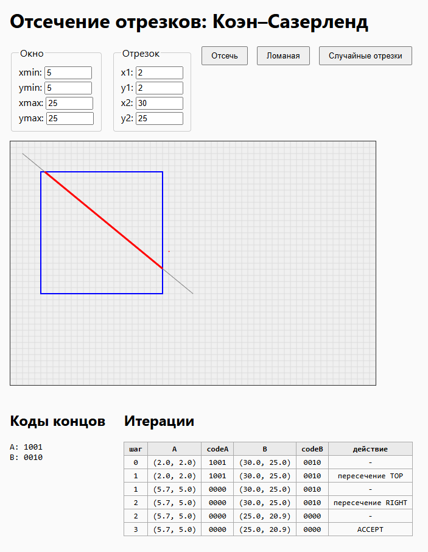

# 1.
    Открыть файл index.html
# 2.
    Во всех тестах использовалось окно :
    (5,5,25,25)
# 3.
    Каждой точке плоскости назначается 4-битный код. Бит устанавливается, если точка находится за соотвествующей границей окна:
        LEFT - 0001, если x < xmin
        RIGHT - 0010, если x > xmax
        BOTTOM - 0100, если y > ymax
        TOP - 1000, если y < ymin
        INSIDE - 0000 означает, что точка находится внутри окна
    Комбинации получаются побитовым ИЛИ. Например, точка слева и сверху имеет код 1001 (LEFT + TOP).
    Быстрые проверки:
        - (code1 | code2) === 0 — оба конца внутри значит ACCEPT (отрезок принимается целиком)
        - (code1 & code2) !== 0 — есть общий внешний бит значит REJECT (отрезок отбрасывается целиком)
# 4.
    1.(10,10) -> (15,15) полностью внутри ACCEPT, отрезок без изменился
    2.(0,10) -> (3,15) полностью слева REJECT, отрезок отбросили
    3.(10,0) -> (15,3) полностью сверху REJECT, отрезок отбросили
    4.(2, 10) -> (15, 10) пересекает левую границу обрезка, обрезан до (5, 10) -> (15, 10)
    5.(2, 10) -> (30, 10) пересекает левую и правую обрезка, обрезан до (5, 10) -> (25, 10)
    6.(2, 2) -> (10, 10) проходит через угол обрезка, обрезан до (5, 5) -> (10, 10)
    7.(10, 2) -> (10, 30) вертикальный обрезка, обрезан до (10, 5) -> (10, 20)
    8.(2, 10) -> (30, 10) горизонтальный обрезка,  обрезан до (5, 10) -> (25, 10)
    9.(2, 2) -> (30, 25)  обе точки снаружи, проходит через окно обрезка, обрезан до (5, 5) -> (25, 20)

# 5.
    Было сгенерировано 200 случайных отрезков.
    Случайных отрезков: 200
    Принято без изменения: 3
    Отсечено:              97
    Отброшено:             100
# Скриншот
