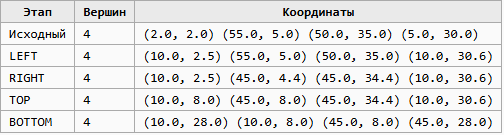

# 1.
    Многоугольники задаем массивом вершин.
# 2.
    xmin = 10,
    ymin = 8,
    xmax = 45,
    ymax = 28
# 3.
   s -> p 
   S(предыдущая)| P(текущая)| Что добавляется в результат
   inside       | inside    |   Только Р 
   inside       | outside   |   Только точка пересечения 
   outside      | inside    |   Точка пересечения, затем Р
   outside      | outside   |   Ничего
# 4.
    С вертикальной границей
        t = (xBoundary - x1) / (x2 - x1)
        y = y1 + t*(y2 -y2)
    C Горизонтальной границей
        t = (yBoundary - y1) / (y2 - y1)
        x = x1 + t*(x2 - x1)    
# 5.
    Тестовый многоугольник (2,2), (55,5), (50, 35), (5, 30)
    

# 6.
    Пусть многоуголник такой же , какой и в 5 вопросе
        S(2,2) -> p(55,5)
        LEFT, x = 10
        S - outside(2 < 10)
        P - inside (55 > 10)
        случай outside-> inside

        t = (10 - 2)/(55-2) = 8 / 53 = 0,1509
        y = 2 + 0,1509*(5-2) = 2 + 0,4528 = 2,45

        Точка пересечения (10, 2,45)
        В массив добавили точку пересечения и вершину P(55,5)
# 7.
    1. Полностью внутри - ок
    2. Полностью снаружи - ок
    3. Пересекает одну границу - ок
    4. Пересекает две границы - ок
    5. Пересекает все 4 - ок
    6. Вершина лежит на границе - ок
    7. Ребро идет вдоль границы - ок
    8. Невыпуклый многоугольник - ок
    9. Результат пуст - ок