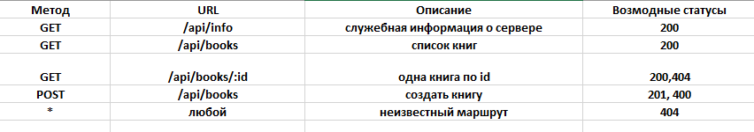

# 1.
    bash
    npm install
# 2.
    npm start
# 3. 
    books
# 4.
    author ?author=Оруэлл - книги этого автора
    available ?available = true - только доступные
    вместе ?author=Оруэлл&available=true - оба условия сразу
# 5.    
    GET /api/books - 6 books, status 200
    GET /api/books?author=Оруэлл - 2 books Ор.б status 200
    GET /api/books/999 - несущ. ID, status 404
 # 6.
       