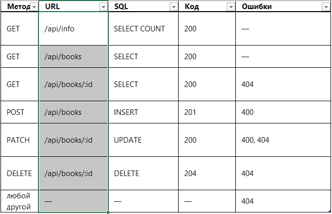

# 1. 
    npm install, npm start

# 2.
    id - первичный ключ
    title - название книги
    author - автор книги
    year - год издания
    available - доступ: 1 - доступна, 0 - не доступно

# 3.
    
# 4.
    POST:
    curl -X POST http://localhost:3000/api/books \
        -H "Content-Type: application/json" \
        -d '{"title":"Мастер и Маргарита","author":"Булгаков","year":1967,"available":true}' -- otvet 201 
    PATCH:
    curl -X PATCH http://localhost:3000/api/books/1 \
        -H "Content-Type: application/json" \
        -d '{"available":false}' -- otvet 200    
# 5.
    author = ' ' - фильтр по автору
    available = true/false - доступно или нет
# 6. 
    1. title, author - не пустые, иначе 400
    2. year - целое число от 0 до текущего года, иначе 400
    3. Нет книги с таким id - 400

# 7.
    После перезагрузки, данные книг остались

